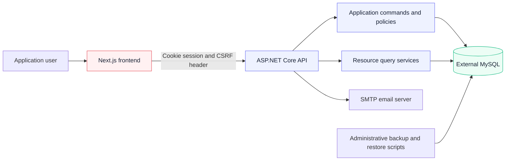

**[Documentation](README.md) / Part I · The application**

# 01 · Application overview

> Understand the product, its features and the concepts behind your finances.

<strong>On this page</strong>

- [1.1 Purpose](#11-purpose)
- [1.2 What is available](#12-what-is-available)
- [1.3 Terminology](#13-terminology)
- [1.4 System structure](#14-system-structure)
- [1.5 Scope and limitations](#15-scope-and-limitations)

---

## 1.1 Purpose

MoneyGestor is a web application for tracking personal finances. You create wallets representing places where you keep money, record income and expenses, move money between wallets, and inspect totals over a selected date range.

The browser provides the interface. An ASP.NET Core API owns authentication, authorization and financial rules. An external MySQL server stores account and financial data. The application does not connect to banks or automatically import bank statements.

## 1.2 What is available

| Area | Current capability |
| --- | --- |
| Accounts | Register, verify email, sign in, inspect the current session, sign out and reset a forgotten password |
| Wallets | Create a wallet with an opening balance and color; edit its name/color; set favorites; delete wallets with no transactions |
| Transactions | Create, edit and delete income, expenses and transfers; search descriptions; filter by kind; navigate server-side pages |
| Dashboard | Select an inclusive date range and view income, expenses and breakdowns by transaction type |
| API | `/api/v1` endpoints for account and financial resources; Identity cookies and Problem Details |
| Presentation | English and Italian routes; shared light/dark styling and responsive components |
| Administration | Health checks, configurable logs, Prometheus metrics, MySQL backup and staging restore scripts |

The API supports additional transaction filters and custom transaction-type creation that the current production pages do not expose as full management interfaces. See [chapter 07](07-api-reference.md).

## 1.3 Terminology

| Term | Meaning |
| --- | --- |
| Wallet | An account, cash reserve or other personal balance tracked by the application |
| Opening balance | The wallet's balance before the transactions recorded in MoneyGestor |
| Current balance | Opening balance plus all signed transaction values affecting that wallet |
| Transaction | A financial entry; called **movimento** in the Italian interface |
| Income | A non-transfer transaction with a positive value |
| Expense | A non-transfer transaction with a negative value |
| Transfer | A linked withdrawal from one wallet and deposit into another wallet owned by the same user |
| Transaction type | A classification used by transactions and dashboard breakdowns |
| Favorite | A wallet preference flag; it does not change balance calculations |

The dashboard may call its type breakdowns “categories.” These are aggregations of existing transaction types, rather than a separate category-management subsystem. Currency presentation is currently EUR; choosing Italian changes formatting, not currency.

## 1.4 System structure

| Location | Responsibility |
| --- | --- |
| `backend/webserver` | HTTP API, authentication, configuration, logging and health endpoints |
| `backend/logic` | Commands, financial invariants, ownership and transaction execution |
| `backend/database` | EF Core contexts, database entities and migrations |
| `backend/TestProject` | NUnit tests, including isolated MySQL integration tests |
| `backend/ExportImportApplication` | Disabled historical ZIP/CSV tool |
| `frontend` | Next.js application, translations and shared UI |
| `ops/database` | Administrative MySQL backup, staging restore and recovery drills |
| `backend/docs` | Application guides and technical reference |
| `docs/all_modernization` | Earlier design, migration, audit and operational records |

The current backend targets .NET 10 and EF Core 10. The frontend uses Next.js 15, React 19 and TypeScript, with Tailwind CSS, local React/HTML UI primitives and next-intl. MUI remains in legacy areas during migration.

## 1.5 Scope and limitations

- Data belongs to individual accounts; shared wallets and collaborative access are not implemented.
- Negative balances are allowed. The application records money rather than enforcing a no-overdraft policy.
- The three-touch mobile Quick Add remains planned. Its old URL redirects to the standard transactions page.
- Reports, budgets, goals, bank synchronization, global search, functional notifications and transaction status are not available workflows. A report link can lead to a placeholder, and decorative elements do not imply an implemented feature.
- The historical ZIP/CSV import/export CLI is disabled. Administrative database backups are a separate workflow.
- Docker Compose starts the frontend and backend, but **does not start MySQL**.

Continue with the [user guide](02-user-guide.md) or [installation instructions](03-installation-and-startup.md).

---

| Previous | Documentation | Next |
| :--- | :---: | ---: |
| [Start here](README.md) | [Index](README.md) | [User guide →](02-user-guide.md) |
