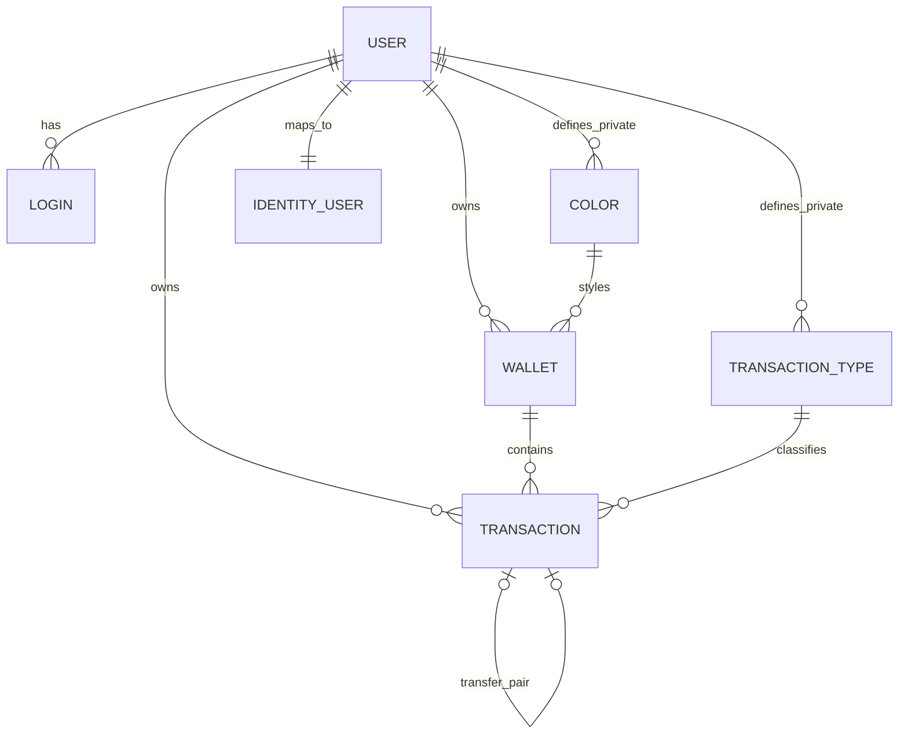

**[Documentation](README.md) / Part II · The implementation**

# 08 · Database and business rules

> Understand data ownership, balance calculations, transfer invariants and schema migrations.

<details>
<summary><strong>On this page</strong></summary>

- [8.1 Persistence structure](#81-persistence-structure)
- [8.2 Ownership and reference data](#82-ownership-and-reference-data)
- [8.3 Money and dates](#83-money-and-dates)
- [8.4 Balance calculation](#84-balance-calculation)
- [8.5 Transfer invariants](#85-transfer-invariants)
- [8.6 Database creation and migrations](#86-database-creation-and-migrations)
- [8.7 Integrity and recovery](#87-integrity-and-recovery)

</details>

---

## 8.1 Persistence structure

One external MySQL database stores financial and Identity tables. `MoneyGestorContext` and `IdentityAccountContext` manage separate entity groups in the same schema and share `__EFMigrationsHistory`.

| Entity / area | Purpose | Important fields or relationships |
| --- | --- | --- |
| `UserDb` | Application user and historical account data | User ID, names, email, username, legacy password representation |
| `LoginDb` | Legacy authentication compatibility | User association, token/session timestamps |
| `WalletDb` | Owned balance container | Opening `Value`, `CurrentValue`, `BalanceVersion`, favorite, color and owner |
| `ColorDb` | Wallet styling | RGB value and optional owner; no owner means global |
| `TransactionTypeDb` | Financial classification | Name and optional owner; no owner means global |
| `TransactionDb` | Signed financial entry | Date, value, descriptions, wallet, type, owner and reciprocal transfer link |
| `ApplicationIdentityUser` | Identity account | Standard Identity properties and unique `LegacyUserId` mapping |
| Identity tables | Authentication infrastructure | Password hashes, normalized identifiers, claims, tokens and security stamps |



Application table names include `user`, `wallet` and `transaction`; inspect the model/migrations rather than guessing SQL naming from C# plural names. API DTO limits can be stricter than database column lengths.

## 8.2 Ownership and reference data

Wallets and transactions belong to exactly one user. The authenticated account supplies that owner. `UserId` and `UserInsertId` are both assigned to the current user; they do not implement sharing.

Global colors/types are available to everyone. Private colors/types are available only to their owner and can be attached only to that user's resources. Wallet names are unique per owner; transaction-type names are unique per owner. Financial lookups do not reveal the existence of another user's resource.

The idempotent startup seed creates global colors and the reserved types **Transfer (ID 1)** and **Adjustment (ID 2)**. Other IDs depend on the installation. There is no separate category entity in the current financial model.

## 8.3 Money and dates

Amounts are .NET `decimal` and MySQL `DECIMAL(19,2)`. The domain range is plus or minus `99,999,999,999,999,999.99`; scale greater than two is rejected, including values whose decimal representation retains extra fractional places. There is no implicit rounding. Normal transaction values cannot be zero; opening/current balances may be zero or negative.

The current frontend transports numbers as JavaScript numbers. At very large amounts, JavaScript cannot represent the backend decimal range exactly; backend storage precision does not guarantee identical precision in every client. Avoid treating the maximum database range as a tested browser-use range.

Transaction dates are .NET `DateOnly` and MySQL `DATE`, with supported years 1000–9999. V1 uses calendar dates such as `2026-10-05`. Legacy timestamp parsing preserves the calendar component. Operational timestamps and sessions use UTC; choosing a display locale does not change stored financial dates.

## 8.4 Balance calculation

For each wallet:

```text
current balance = opening balance + sum(all signed transaction values in that wallet)
```

`CurrentValue` is stored for efficient reads. Commands maintain it when creating, editing, moving or deleting a transaction. `BalanceVersion` is a concurrency token. Ordered locks and bounded retries protect concurrent mutations; retries can rerun the unit of work with a fresh context, up to five attempts.

Reconciliation compares the stored balance with the calculated balance in read-only mode. Financial integrity problems are reported rather than silently repaired. Do not directly edit balances or transfer rows as a substitute for application commands.

## 8.5 Transfer invariants

A transfer requires a positive requested magnitude and two distinct wallets belonging to the same user. The backend writes reciprocal rows with equal and opposite values: negative in the source, positive in the destination. The pair must sum to zero and share coherent type/owner/date information.

Creation and mutation of the pair are atomic. List queries hide the positive destination row so one transfer appears once. Dashboard totals exclude transfers. Deleting a transfer removes both sides and reverses both wallet effects.

## 8.6 Database creation and migrations

| Context | Current initial migration |
| --- | --- |
| MoneyGestor | `20261001180542_InitialMoneyGestorSchema` |
| Identity | `20261001181454_InitialIdentitySchema` |

The current migration baseline targets an empty database. An older populated schema without the new initial migration is refused. The old schema-adoption procedure mentioned in historical evidence is not the current startup behavior.

Use `database.bootstrapMode=Migrate` only for a verified deployment target with adequate privileges and backups, then return to `Disabled`. Both contexts must be current for startup to succeed. Seed and integrity checks run after schema preparation.

For reviewing SQL, restore the repository-local EF tool and set `MONEYGESTOR_DESIGN_CONNECTION_STRING` privately in the administrative environment:

```powershell
dotnet tool restore
dotnet tool run dotnet-ef migrations script --project backend/database/database.csproj --context MoneyGestorContext
dotnet tool run dotnet-ef migrations script --project backend/database/database.csproj --context IdentityAccountContext
```

Generating scripts does not apply them. Database-update commands and startup with `Migrate` do modify the configured target. The initial migrations' Down methods remove tables; recovery should use a verified backup in a separate schema and a compatible application version, rather than an unreviewed downgrade.

## 8.7 Integrity and recovery

Startup checks financial ownership, references, balances and transfer pairs and refuses known inconsistencies. Identity mapping also checks normalized account collisions. Failures expose technical identifiers/counts instead of automatically changing records.

For an old schema, preserve the original and plan an explicit conversion or separate installation. For corrupted/current data, collect technical evidence and use the [backup and staging restore workflow](09-operations-and-recovery.md). Changing bootstrap mode does not repair financial inconsistencies.


---

| Previous | Documentation | Next |
| :--- | :---: | ---: |
| [← API reference](07-api-reference.md) | [Index](README.md) | [Operations and recovery →](09-operations-and-recovery.md) |
