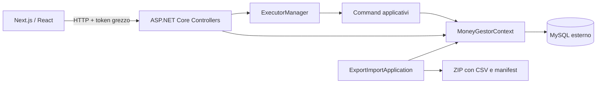
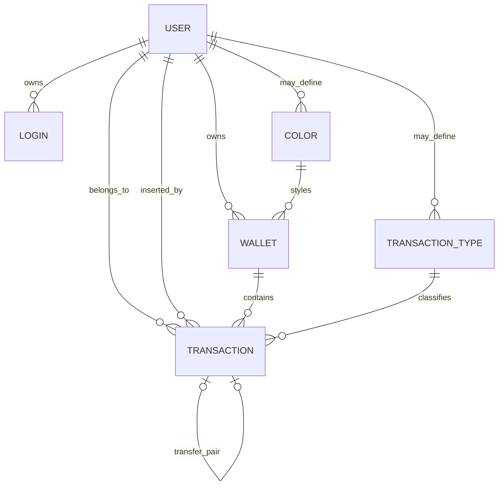

# Architettura

Questa descrizione fotografa il repository al 10 settembre 2026.

## Vista generale

Il frontend concentra le chiamate HTTP in `frontend/src/hooks/useApi.ts`. I controller traducono le richieste nei comandi del progetto `logic`; `ExecutorManager` apre una transazione EF, risolve l'utente dal token ed esegue il comando. Alcune letture interrogano invece `MoneyGestorContext` direttamente dal controller.

## Progetti backend

### `database`

Contiene `MoneyGestorContext` e le entità persistenti:

- `UserDb`
- `LoginDb`
- `ColorDb`
- `WalletDb`
- `TransactionTypeDb`
- `TransactionDb`

Il provider è `MySql.EntityFrameworkCore`. La stringa di connessione è costruita da valori statici inizializzati all'avvio.

### `logic`

Contiene:

- autenticazione e generazione token;
- hashing password PBKDF2;
- comandi applicativi per utenti, wallet e transazioni;
- gestione atomica tramite `ExecutorManager`;
- filtri dinamici per lista, ordinamento e paginazione;
- conversione tra entità database e modelli API.

Ogni `Execute` apre una transazione, aggiorna la scadenza del token quando presente, esegue il comando e fa commit o rollback.

### `webserver`

Espone controller REST per:

- utenti e login;
- colori;
- wallet;
- tipi di transazione;
- transazioni;
- dashboard.

Swagger viene registrato sempre ma pubblicato solo in ambiente Development. Le risposte applicative usano l'envelope descritto in [API.md](API.md).

### `ExportImportApplication`

CLI per esportare le tabelle in CSV, aggiungere `export_detail.json` e creare un archivio ZIP. L'import crea un database sostitutivo, popola le tabelle e rimuove il precedente database se l'operazione termina con successo.

Questa operazione è ad alto impatto e presenta limiti di affidabilità documentati in [PROJECT_AUDIT.md](PROJECT_AUDIT.md).

### `TestProject`

Suite NUnit soprattutto sui comandi applicativi. I test sono integration test: usano MySQL, non un database in memoria. Sono presenti 61 metodi marcati `[Test]`, di cui almeno uno è esplicitamente inconcludente.

## Modello dati

`TransactionDb` distingue l'utente a cui appartiene il movimento (`UserId`) dall'utente che lo ha inserito (`UserInsertId`). Oggi il client può inviare `UserId`; questa capacità non è accompagnata da un modello di condivisione o permessi esplicito.

## Regole di dominio osservate

- Un wallet nasce con `Value` e `CurrentValue` uguali.
- Un movimento normale somma il proprio valore a `CurrentValue`.
- Salvo operazioni forzate interne, un wallet non può scendere sotto zero.
- Un trasferimento è rappresentato da due transazioni collegate: valore negativo nel wallet origine e positivo nel wallet destinazione.
- La lista mostra un solo lato del trasferimento.
- Colori e tipi con `UserId = null` sono globali.
- I tipi globali iniziali sono `Transfer` (ID 1) e `Adjustment` (ID 2).

## Autenticazione attuale

Il login crea un token casuale memorizzato in chiaro nella tabella `login`. Il token dura due ore, oppure trenta giorni con `remember`, e la scadenza viene estesa a ogni richiesta autenticata. Il frontend lo conserva in un cookie leggibile da JavaScript e lo invia come valore grezzo dell'header `Authorization`.

Non è usato il middleware ASP.NET Core Authentication/Authorization; ogni endpoint richiama manualmente `ExecutorManager.LoginUser()` oppure esegue un comando che lo richiama.

## Avvio e configurazione

Il backend esegue `EnsureCreated` e inizializza colori e tipi globali a ogni avvio. Non sono presenti migration EF. `forceUpdate` è definito nella configurazione ma non influenza il flusso di startup.

Il Compose avvia backend, frontend e, su profilo `tools`, la CLI; MySQL resta esterno.
