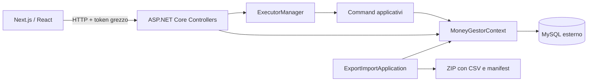
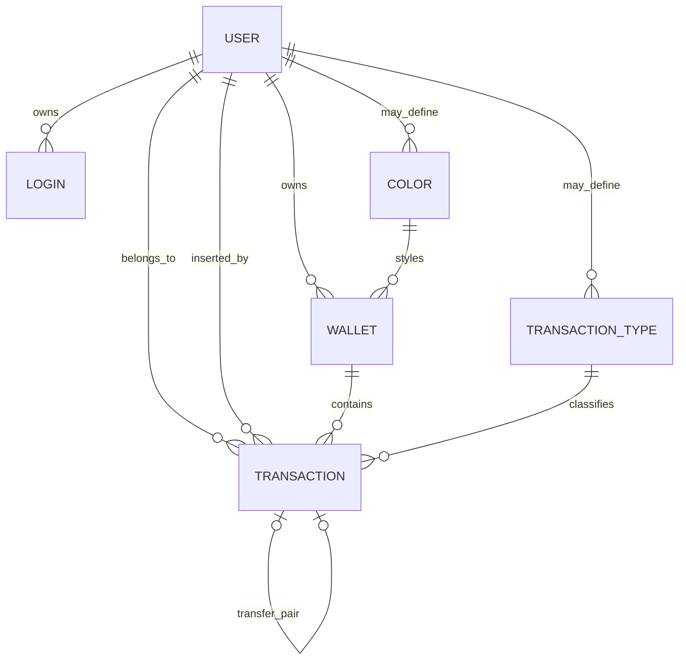

# Architettura

Questa descrizione fotografa il repository, aggiornato al 23 settembre 2026.

## Vista generale

Il frontend concentra ancora le chiamate HTTP legacy in `frontend/src/hooks/useApi.ts`. Il nuovo boundary di
presentazione usa adapter puri per trasformare i DTO in view model di feature e componenti visuali pilotati tramite
props; fixture locali coprono gli stati `idle`, `loading`, `ready`, `empty` ed `error` senza richiedere il backend. I
controller traducono le richieste nei comandi del progetto `logic`; `ExecutorManager` apre una transazione EF, risolve
l'utente dal token ed esegue il comando. Alcune letture interrogano invece `MoneyGestorContext` direttamente dal
controller.

Questa è la fotografia dell'implementazione corrente. La destinazione frontend già approvata è Next.js App Router con Tailwind CSS, shadcn/ui su Radix e next-intl, senza TanStack; MUI verrà rimosso progressivamente per slice. Architettura di transizione, confini e ordine operativo sono definiti nel [piano di migrazione frontend](FRONTEND_MIGRATION_PLAN.md), mentre [UI_DESIGN_SYSTEM.md](UI_DESIGN_SYSTEM.md) e [INTERNATIONALIZATION.md](INTERNATIONALIZATION.md) sono i contratti trasversali.

## Progetti backend

### `database`

Contiene `MoneyGestorContext` e le entità persistenti:

- `UserDb`
- `LoginDb`
- `ColorDb`
- `WalletDb`
- `TransactionTypeDb`
- `TransactionDb`

Il provider è `MySql.EntityFrameworkCore`. La stringa di connessione è costruita da valori statici inizializzati all'avvio.

### `logic`

Contiene:

- autenticazione e generazione token;
- hashing password PBKDF2;
- comandi applicativi per utenti, wallet e transazioni;
- gestione atomica tramite `ExecutorManager`;
- filtri dinamici per lista, ordinamento e paginazione;
- conversione tra entità database e modelli API.

Ogni `Execute` apre una transazione, aggiorna la scadenza del token quando presente, esegue il comando e fa commit o rollback.

### `webserver`

Espone controller REST per:

- utenti e login;
- colori;
- wallet;
- tipi di transazione;
- transazioni;
- dashboard.

Swagger viene registrato sempre ma pubblicato solo in ambiente Development. Le risposte applicative usano l'envelope descritto in [API.md](API.md).

### `ExportImportApplication`

CLI per esportare le tabelle in CSV, aggiungere `export_detail.json` e creare un archivio ZIP. L'import crea un database sostitutivo, popola le tabelle e rimuove il precedente database se l'operazione termina con successo.

Questa operazione è ad alto impatto e presenta limiti di affidabilità documentati in [PROJECT_AUDIT.md](PROJECT_AUDIT.md).

### `TestProject`

Suite NUnit per command, guardie infrastrutturali e pipeline HTTP. Gli integration test usano un container MySQL 8.4
effimero per run, con database, credenziali e porta casuali; non esiste fallback verso un database locale condiviso.
La suite validata comprende 99 casi verdi. I casi cross-user fanno parte della suite ordinaria insieme ai test di
ownership, conflitto concorrente, invarianti dei trasferimenti e preflight di integrità introdotti da SEC-11..13.
L'esecuzione completa richiede Docker ed è registrata nell'evidenza dello step.

## Modello dati

`TransactionDb` conserva sia `UserId` sia `UserInsertId` per compatibilità dello schema, ma la policy corrente è di
ownership singola: entrambi sono sempre impostati all'utente autenticato. Il client non può scegliere l'owner e non
esiste un modello di sharing implicito.

## Regole di dominio osservate

- Un wallet nasce con `Value` e `CurrentValue` uguali.
- Un movimento normale somma il proprio valore a `CurrentValue`.
- I saldi iniziali e correnti possono essere negativi; non esistono bypass `force` nei comandi pubblici o interni.
- Un trasferimento accetta un importo positivo e viene rappresentato da due transazioni reciproche: valore negativo
  nel wallet origine e positivo nel wallet destinazione, con wallet distinti dello stesso owner e somma zero.
- La lista mostra soltanto il lato origine del trasferimento.
- Colori e tipi con `UserId = null` sono globali.
- Colori e tipi privati possono essere associati soltanto a risorse dello stesso utente.
- I tipi globali iniziali sono `Transfer` (ID 1) e `Adjustment` (ID 2).

## Autenticazione attuale

La nuova `/api/v1/auth` usa ASP.NET Core Identity. Il browser riceve soltanto il cookie cifrato `MoneyGestor.Auth`,
`HttpOnly`, `SameSite=Lax` e `Secure` in produzione; le mutazioni `/api/v1` richiedono il token antiforgery dedicato.
Login, sessione, logout, conferma email e recupero password passano dal middleware standard. Gli utenti Identity
mantengono un mapping univoco verso `UserDb.Id`, così ownership e dati finanziari non cambiano.

Gli hash PBKDF2 legacy sono accettati una sola volta dal password hasher compatibile e riscritti nel formato Identity
al primo login riuscito. Gli endpoint non versionati restano temporaneamente compatibili col token grezzo: per il
frontend autenticato un ponte server-side genera l'header legacy senza esporre il token a JavaScript. `/api/v1` non
accetta tale token.

## Avvio e configurazione

Il backend esegue ancora `EnsureCreated` per lo schema storico e inizializza colori e tipi globali a ogni avvio. Lo
schema Identity ha invece migration EF dedicate, applicate soltanto con `database.forceUpdate=true`; con migration
pendenti e flag disabilitato lo startup fallisce. Subito dopo esegue un preflight
read-only su ownership e coppie di trasferimento: eventuali anomalie bloccano l'avvio riportando soltanto conteggi e
ID tecnici, senza correzioni automatiche o PII, e il bootstrap Identity blocca collisioni normalizzate.

Il Compose avvia backend, frontend e, su profilo `tools`, la CLI; MySQL resta esterno.

## Logging sicuro

I log HTTP contengono soltanto metodo, route, status, durata, codice applicativo e trace ID; non includono header,
body o dati della risposta. Il sensitive-data logging di EF è disabilitato. Gli eventi SQL senza valori dei parametri
sono disponibili esclusivamente con livello `Trace`/`Verbose` in ambiente `Development` e restano disabilitati in
`Production`. Gli errori della CLI registrano l'operazione e il tipo di eccezione, non il messaggio potenzialmente
derivato dall'input. I sink su file applicano rolling giornaliero e conservano al massimo 14 file.
