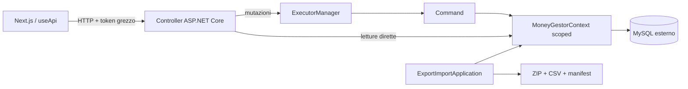
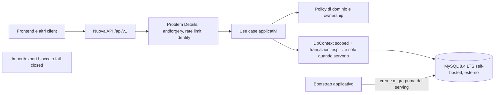

# Modernizzazione backend di MoneyGestor

- Stato del documento: **Fase 0 completata; Fase 1 completata; ARC-20 e DB-21 completati**
- Data dell'ultimo aggiornamento: **24 settembre 2026**
- Ambito analizzato: `backend/`, contratto HTTP corrente, integrazione frontend, configurazione, Docker e test.

## Scopo e regole

Questa cartella è la fonte operativa per modernizzare il backend in modo incrementale. La ricognizione che l'ha
prodotta non ha modificato codice, dipendenze, configurazione, database o infrastruttura. I soli nuovi artefatti sono
file Markdown.

La modernizzazione deve conservare il sistema funzionante al termine di ogni step. Non sono previste riscritture
complete, microservizi, event sourcing, CQRS, repository generici o l'introduzione di MediatR: nessuno di questi
strumenti risolve un problema dimostrato dal repository. EF Core può continuare a essere unit of work e boundary di
persistenza, purché sia usato tramite dependency injection e non venga esposto direttamente dall'API.

## Come usare questi documenti

1. Leggere [l'analisi tecnica](TECHNICAL_ANALYSIS.md) per distinguere difetti confermati, rischi condizionati e
   opportunità.
2. Applicare le [decisioni architetturali approvate](DECISIONS_REQUIRED.md). Gli step riportano gli ID da rispettare.
3. Seguire [la roadmap](ROADMAP.md) nell'ordine indicato. Non iniziare una fase se il gate precedente non è soddisfatto.
4. Assegnare a un'AI un solo step alla volta copiando la relativa scheda di fase. Ogni scheda contiene obiettivo,
   prerequisiti, file, istruzioni, vincoli, rischi, verifiche e criteri di completamento.
5. Al termine di uno step aggiornare il suo stato in `ROADMAP.md`, allegare l'esito delle verifiche e aggiornare i
   documenti che descrivono un contratto effettivamente cambiato.

Documenti operativi:

- [Analisi tecnica completa](TECHNICAL_ANALYSIS.md)
- [Decisioni architetturali approvate](DECISIONS_REQUIRED.md)
- [Compatibilità API e frontend](API_COMPATIBILITY.md)
- [Roadmap e dipendenze](ROADMAP.md)
- [Runbook database: deployment, adozione e recovery](DATABASE_DEPLOYMENT.md)
- [Fase 0 — baseline e rete di sicurezza](phases/PHASE_0_BASELINE_AND_SAFETY.md)
- [Fase 1 — hardening di sicurezza](phases/PHASE_1_SECURITY.md)
- [Fase 2 — persistenza e correttezza economica](phases/PHASE_2_DATA_AND_PERSISTENCE.md)
- [Fase 3 — contratto API e architettura applicativa](phases/PHASE_3_API_AND_APPLICATION.md)
- [Fase 4 — blocco import/export](phases/PHASE_4_IMPORT_EXPORT.md)
- [Fase 5 — qualità operativa e piattaforma](phases/PHASE_5_OPERATIONS_AND_DELIVERY.md)

## Sintesi esecutiva

Il backend non richiede una riscrittura. Ha già una separazione comprensibile fra API, logica, persistenza, CLI e test;
usa transazioni per le mutazioni composte; modella i trasferimenti come coppie collegate; usa hash PBKDF2 con salt e
confronto a tempo costante; applica indici univoci ad alcuni vincoli essenziali; e dispone ora di una suite sicura con
131 casi ordinari fra command, infrastruttura, pipeline HTTP, Identity, migration, redazione dei log, lifetime DI e
concorrenza economica.

La base è però fragile per dati reali o uso multiutente. Le priorità confermate sono:

1. **Isolamento fra utenti.** SEC-11 e SEC-12 hanno introdotto policy riusabili owner/global, lookup non enumerabili e
   ownership singola dei movimenti derivata dal principal. I profili utente non vengono più inclusi nei movimenti e il
   preflight blocca dati storici incoerenti senza correggerli automaticamente. I due step sono completati.
2. **Protezione dei segreti.** SEC-10 ha rimosso il sensitive-data logging EF, il token dalle eccezioni e i payload dai
   log HTTP. Gli eventi SQL senza valori sono ora limitati a `Development + Trace`; restano da mantenere queste
   garanzie negli step successivi.
3. **Sicurezza delle operazioni distruttive.** I test usano un MySQL effimero di proprietà del singolo run. La CLI
   import/export resta invece raggiungibile e deve essere disabilitata fail-closed da BAK-40 prima di trattare dati
   reali; il vecchio flusso di import non offre ancora garanzie sufficienti di staging e recovery.
4. **Integrità economica.** SEC-13 ammette saldi negativi e valida atomicamente coppie di trasferimento reciproche,
   distinte e a somma zero. DAT-22..24 hanno completato `decimal`/`DECIMAL(19,2)`, data civile `DateOnly`/`DATE`, token
   saldo, lock ordinati, retry bounded e riconciliazione read-only fail-closed.
5. **Evoluzione dello schema.** DB-21 ha introdotto baseline e migration EF, bootstrap fail-closed, adozione strutturale
   dello schema legacy e seed transazionale. Le modifiche future devono aggiungere migration forward e seguire il
   runbook di deployment/recovery.
6. **Contratto HTTP.** La validazione è manuale e parziale, quasi tutte le eccezioni diventano 500, l'autenticazione è
   ripetuta negli action method e filtri/ordinamenti riflettono liberamente sulle entità persistenti.
7. **Qualità verificabile.** La Fase 0 ha aggiunto i primi test HTTP e rimosso Playwright con la vulnerabilità
   transitiva nota. Restano assenti test round-trip della CLI, CI e una copertura HTTP completa.
8. **Ciclo di vita runtime.** Il progetto usa .NET 8, che al 20 settembre 2026 è in maintenance e termina il supporto il
   10 novembre 2026. Il passaggio a .NET 10 LTS va pianificato, ma dopo la rete di sicurezza e senza mescolarlo ai fix di
   autorizzazione.

## Architettura attuale

La separazione per progetti è leggibile, ma i confini applicativi restano incompleti: `webserver` referenzia sia
`logic` sia `database`, i controller eseguono ancora query EF e i DTO vivono in `logic`. ARC-20 ha però chiuso il
lifetime infrastrutturale: options validate, context scoped e `TimeProvider` iniettato sono ora implementati.

## Destinazione proposta

Caratteristiche della destinazione:

- configurazione tipizzata con `IOptions` e validazione all'avvio;
- `DbContext` scoped tramite DI e `TimeProvider` iniettato;
- ASP.NET Core Identity con cookie HttpOnly, antiforgery, verifica email e provider esterni aggiungibili;
- policy di ownership unica e riusabile per portafogli, colori, tipi e movimenti;
- nuova API `/api/v1` con DTO separati dalle entità EF, risposte tipizzate e Problem Details;
- `decimal` e colonne `DECIMAL`, date di dominio esplicite, migration versionate e seed idempotente osservabile;
- saldo denormalizzato mantenuto inizialmente per compatibilità, ma protetto dalla concorrenza e riconciliabile;
- import/export bloccato prima di settings, file o database finché non verrà riaperta la decisione di prodotto;
- test unitari rapidi, integration test MySQL isolati e contract test HTTP;
- logging strutturato senza segreti e con sink/livelli/rolling/retention da file di configurazione;
- health check, metriche minime e pipeline CI senza container MySQL nel deployment applicativo.

Non è necessario creare subito altri progetti .NET. I confini possono essere corretti dentro la soluzione corrente;
un'eventuale rinomina o suddivisione dei progetti deve essere l'ultimo esito di una necessità misurata, non un
prerequisito.

## Baseline verificata

La baseline iniziale è [BSL-00 del 21 settembre 2026](evidence/BSL-00_2026-09-21.md); l'esito aggiornato è nel
[completamento della Fase 0](evidence/PHASE_0_2026-09-21.md).

SEC-10 è documentato nell'[evidenza del 22 settembre 2026](evidence/SEC-10_2026-09-22.md). SEC-11, SEC-12 e SEC-13
sono documentati nell'[evidenza del 23 settembre 2026](evidence/SEC-11_SEC-12_SEC-13_2026-09-23.md).

| Elemento | Risultato al 21 settembre 2026 |
|---|---|
| Progetti soluzione | `database`, `logic`, `webserver`, `TestProject`, `ExportImportApplication` |
| Codice produttivo | 80 file C#, circa 3.823 righe |
| Test | 29 file C#, circa 1.990 righe; 73 casi ordinari e 4 casi cross-user `Explicit`; 0 `Assert.Inconclusive` |
| Build pulita | `dotnet build backend/backend.sln --no-restore -t:Rebuild`: 0 errori, 78 warning |
| Test eseguiti | 73/73 verdi in tre run consecutivi e nel run conclusivo su MySQL 8.4 effimero |
| Migration EF | assenti |
| Test HTTP / CLI | 5 test HTTP/Swagger; test CLI assenti perché la feature resta bloccata da DEC-08 |
| CI | assente |
| Database in Compose | assente, MySQL è esterno |
| Vulnerabilità osservata | nessuna nel nuovo audit NuGet top-level/transitivo |

L'audit NuGet è stato completato usando le origini configurate nell'ambiente. Playwright e `System.Text.Json 6.0.5`
non sono più presenti nel grafo backend.

## Protocollo per ogni AI esecutrice

Prima di iniziare uno step:

1. leggere `AGENTS.md`, questo indice, `ROADMAP.md`, la scheda dello step e le decisioni da cui dipende;
2. controllare `git status --short` usando una configurazione locale al comando se Git segnala `dubious ownership`;
3. non leggere né mostrare `settings.json`; usare `settings.example.json`;
4. acquisire una baseline delle verifiche previste dallo step;
5. modificare solo i file elencati, salvo aggiornamenti documentali e file generati esplicitamente previsti;
6. non cambiare insieme contratto HTTP, schema dati e frontend senza una strategia di compatibilità descritta;
7. distinguere fallimenti introdotti, preesistenti e verifiche non eseguite;
8. aggiornare lo stato dello step solo dopo che tutti i criteri di completamento sono oggettivamente soddisfatti.

Stati ammessi in `ROADMAP.md`: `non iniziato`, `in corso`, `bloccato`, `completato`. “Completato” richiede evidenza
dei comandi e dei test indicati nella scheda; non basta che il codice compili.

## Principi invarianti

- Il frontend in migrazione resta Next.js App Router, senza TanStack, e riceve numeri/date neutrali da localizzare con
  `next-intl`; il backend non deve restituire stringhe monetarie o date già localizzate.
- Nei testi UI si usa “movimento”; nei nomi tecnici può restare `Transaction`.
- L'envelope `{ code, message, data }` e il token grezzo appartengono solo al contratto legacy durante la finestra di
  compatibilità; la nuova `/api/v1` usa Identity cookie, successi tipizzati e Problem Details.
- Le regole economiche, ownership, aggregazioni e validazione di dominio restano nel backend.
- Nessuna dipendenza legacy viene rimossa senza una ricerca completa dei consumer.
- Nessuna migration distruttiva viene applicata a un database non identificato e sottoposto a backup verificato.
- I test non possono conoscere o cancellare un database condiviso; il nome deve essere casuale e la distruzione
  protetta da più guardie.
- Token, password hash, stringhe di connessione e dati finanziari non devono entrare in log, errori o artefatti CI.

## Riferimenti esterni verificati

- [.NET support policy](https://dotnet.microsoft.com/en-us/platform/support/policy): .NET 8 termina il supporto il
  10 novembre 2026; .NET 10 LTS è supportato fino al 14 novembre 2028.
- [NuGet — System.Text.Json 6.0.5](https://www.nuget.org/packages/System.Text.Json/6.0.5): pacchetto deprecato e con
  vulnerabilità High.
- [MySQL Connector/NET — supporto EF Core](https://dev.mysql.com/doc/connector-net/en/connector-net-entityframework-core.html):
  la combinazione di runtime, EF Core, provider e server MySQL va verificata come insieme prima di ogni upgrade.
- [ASP.NET Core Identity con provider esterni](https://learn.microsoft.com/en-us/aspnet/core/security/authentication/social/):
  Identity permette di aggiungere provider come Google mantenendo account e sessione applicativi.
- [MySQL 8.4 Reference Manual](https://dev.mysql.com/doc/refman/8.4/en/): 8.4 è la linea LTS scelta come obiettivo
  iniziale, subordinata alla compatibilità verificata del provider EF.
