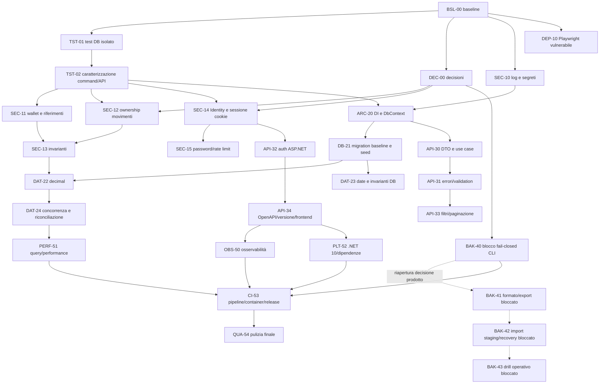

# Roadmap di modernizzazione backend

Le decisioni DEC-01..10 sono approvate e lo step documentale DEC-00 è **completato** il 20 settembre 2026. Gli step di
implementazione restano non iniziati, salvo BAK-41..43 che sono bloccati dalla decisione di prodotto. La numerazione
esprime dipendenze, non stime temporali.

## Legenda

- Priorità `P0`: prima di dati reali, multiutente o esecuzioni distruttive.
- Priorità `P1`: prima di ampliare feature/traffico.
- Priorità `P2`: qualità operativa e manutenibilità.
- Stato: `non iniziato`, `in corso`, `bloccato`, `completato`.
- `Gate`: condizione che blocca la fase successiva.

## Vista delle dipendenze



## Sequenza raccomandata

### Fase 0 — baseline e rete di sicurezza

Scheda: [PHASE_0_BASELINE_AND_SAFETY.md](phases/PHASE_0_BASELINE_AND_SAFETY.md)

| ID | Priorità | Stato | Titolo | Prerequisiti |
|---|---:|---|---|---|
| BSL-00 | P0 | completato (21 settembre 2026) | baseline riproducibile e registro rischi | nessuno |
| DEC-00 | P0 | completato | decisioni DEC-01..10 registrate e propagate nel piano | audit esistente |
| TST-01 | P0 | non iniziato | MySQL test effimero e guardie distruttive | BSL-00 |
| TST-02 | P0 | non iniziato | riparazione test e caratterizzazione del comportamento | TST-01 |
| DEP-10 | P1 | non iniziato | rimozione Playwright backend inutilizzato e audit | BSL-00 |

**Gate fase 0:** i test non possono toccare un DB non creato dal run; baseline build/test/contract registrata; decisioni
DEC-01..10 applicate; vulnerabilità transitiva nota rimossa o eccezione formale.

**Fast-track obbligatorio per la CLI:** DEC-08 ne impone la disabilitazione. Eseguire BAK-40 subito dopo TST-01 e prima
di usare la CLI o trattare dati reali; fino ad allora non eseguire `ExportImportApplication` in alcun ambiente.

### Fase 1 — hardening di sicurezza

Scheda: [PHASE_1_SECURITY.md](phases/PHASE_1_SECURITY.md)

| ID | Priorità | Stato | Titolo | Prerequisiti |
|---|---:|---|---|---|
| SEC-10 | P0 | non iniziato | disabilitare logging sensibile e redigere segreti | BSL-00 |
| SEC-11 | P0 | non iniziato | ownership portafogli, colori e tipi | TST-02 |
| SEC-12 | P0 | non iniziato | ownership movimenti e preflight bloccante | DEC-01, DEC-09, TST-02 |
| SEC-13 | P1 | non iniziato | saldi negativi e invarianti dei trasferimenti | DEC-05, SEC-11, SEC-12 |
| SEC-14 | P1 | non iniziato | ASP.NET Core Identity, cookie e migrazione account | DEC-02, TST-02 |
| SEC-15 | P1 | non iniziato | verifica email, recupero, validation anti-abuso e rate limit | DEC-07, DEC-10, SEC-14 |

SEC-10 può procedere in parallelo con TST-01 perché cambia solo logging e ha verifiche non distruttive. Gli altri fix
richiedono la rete di sicurezza.

**Gate fase 1:** matrice cross-user verde su ogni endpoint; nessun token/hash/payload finanziario nei log; sessioni
Identity revocabili; verifica email e recupero provati; riferimenti globali/personali validati; CLI sempre bloccata.

### Fase 2 — persistenza e correttezza economica

Scheda: [PHASE_2_DATA_AND_PERSISTENCE.md](phases/PHASE_2_DATA_AND_PERSISTENCE.md)

| ID | Priorità | Stato | Titolo | Prerequisiti |
|---|---:|---|---|---|
| ARC-20 | P1 | non iniziato | Options, DI e `DbContext` scoped | SEC-10, TST-02 |
| DB-21 | P1 | non iniziato | bootstrap da zero, migration baseline e seed osservabile | ARC-20 |
| DAT-22 | P1 | non iniziato | migrazione `Double` → `decimal`/`DECIMAL` | DEC-04, DEC-09, DB-21, SEC-13 |
| DAT-23 | P1 | non iniziato | `DateOnly`/`DATE` e constraint di dominio | DEC-05, DEC-06, DEC-09, DB-21 |
| DAT-24 | P1 | non iniziato | concorrenza saldo e riconciliazione | DAT-22, DAT-23 |

**Gate fase 2:** nessun `Double` monetario; migration up/down provate su copia; seed fallisce in modo osservabile;
saldo concorrente non perde aggiornamenti; report di riconciliazione pulito, altrimenti migration/avvio bloccati con
eccezione DEC-09.

### Fase 3 — API e applicazione

Scheda: [PHASE_3_API_AND_APPLICATION.md](phases/PHASE_3_API_AND_APPLICATION.md)

| ID | Priorità | Stato | Titolo | Prerequisiti |
|---|---:|---|---|---|
| API-30 | P1 | non iniziato | DTO e use case/query service sottili | ARC-20, DEC-03 |
| APP-31 | P1 | non iniziato | policy di dominio/ownership riusabili | API-30, SEC-13 |
| API-31 | P1 | non iniziato | validation e Problem Details centrali | API-30 |
| API-32 | P1 | non iniziato | cookie Identity, antiforgery e authorization | SEC-14, ARC-20 |
| API-33 | P1 | non iniziato | filtri allowlist e paginazione deterministica | API-31 |
| API-34 | P1 | non iniziato | nuova `/api/v1`, OpenAPI e migrazione frontend | API-31, API-32, API-33, DEC-03 |

**Gate fase 3:** controller senza query EF o autenticazione manuale; nessuna entità EF nell'HTTP; successi e Problem
Details coperti; OpenAPI `/api/v1` diffata in test; frontend migrato e legacy/raw ritirati solo dopo prova consumer.

### Fase 4 — blocco import/export

Scheda: [PHASE_4_IMPORT_EXPORT.md](phases/PHASE_4_IMPORT_EXPORT.md)

| ID | Priorità | Stato | Titolo | Prerequisiti |
|---|---:|---|---|---|
| BAK-40 | P0 | non iniziato | disabilitazione fail-closed della CLI | DEC-08, TST-01 |
| BAK-41 | P1 | bloccato | formato robusto ed export consistente | nuova decisione di prodotto |
| BAK-42 | P0 | bloccato | import staging, swap e recovery | nuova decisione di prodotto |
| BAK-43 | P1 | bloccato | operatività e recovery drill | nuova decisione di prodotto |

BAK-41..43 non vanno implementati finché il proprietario non riapre DEC-08 chiarendo lo scopo della funzionalità.
Il codice storico può restare come riferimento temporaneo, ma non deve essere raggiungibile da Compose o release.

**Gate fase 4:** ogni comando CLI fallisce prima di leggere settings, aprire MySQL o toccare archivi; nessun servizio
import/export è presente nel deployment. Il gate non richiede round-trip o restore finché la feature resta bloccata.

### Fase 5 — qualità operativa e piattaforma

Scheda: [PHASE_5_OPERATIONS_AND_DELIVERY.md](phases/PHASE_5_OPERATIONS_AND_DELIVERY.md)

| ID | Priorità | Stato | Titolo | Prerequisiti |
|---|---:|---|---|---|
| OBS-50 | P2 | non iniziato | logging configurabile, health, metriche e tracing minimo | API-34 |
| PERF-51 | P2 | non iniziato | query, async, cancellation e resource lifetime | DAT-24, API-34 |
| PLT-52 | P1 | non iniziato | allineamento dipendenze e .NET 10 LTS | API-34, DB-21 |
| CI-53 | P1 | non iniziato | CI, container C# e release/migration workflow | BAK-40, OBS-50, PERF-51, PLT-52 |
| QUA-54 | P3 | non iniziato | warning zero e rimozione codice legacy/template | CI-53 |

**Gate finale:** build/test/audit riproducibili in CI; 0 warning concordati; deploy e migration con rollback; health e
telemetria senza segreti; documentazione principale allineata allo stato implementato.

## Percorso minimo di riduzione del rischio

Se il tempo è limitato, non saltare direttamente a .NET 10 o alla riorganizzazione dei progetti. Il percorso minimo è:

1. BSL-00, TST-01, TST-02;
2. BAK-40, applicando DEC-08 già approvata;
3. SEC-10, SEC-11, SEC-12;
4. DEP-10;
5. SEC-13, SEC-14 e SEC-15;
6. ARC-20 e DB-21;
7. DAT-22, DAT-23 e DAT-24;
8. API-30, API-31, API-32 e API-34 per la nuova `/api/v1`.

Questo chiude i rischi più gravi lasciando runtime e contratto quasi invariati.

## Regole di avanzamento

- Un PR/commit dovrebbe contenere un solo step o una coppia dichiarata inseparabile nella scheda.
- Ogni migration DB vive in uno step dedicato con backup, preflight, forward test e rollback/recovery.
- Un test modificato per farlo passare deve avere una motivazione di comportamento; non abbassare le asserzioni.
- Se emerge un nuovo P0, fermare gli step non correlati, registrarlo nell'analisi e inserirlo prima del gate corrente.
- Se una verifica dipende da MySQL o infrastruttura non disponibile, lo step resta non completato/bloccato: non sostituire
  l'evidenza con una supposizione.
- Aggiornare `docs/ARCHITECTURE.md`, `docs/API.md`, `docs/PROJECT_AUDIT.md` e il README radice solo quando il codice
  effettivo cambia; questo piano da solo non cambia lo stato dell'applicazione.

## Evidenza da allegare a ogni completamento

```text
Step: <ID>
Commit/PR: <riferimento>
Decisioni applicate: <DEC-ID e valore>
File modificati: <elenco>
Migration: <nome oppure nessuna>
Verifiche eseguite: <comando + esito>
Verifiche non eseguite: <motivo>
Problemi introdotti: <nessuno/elenco>
Problemi preesistenti: <elenco>
Rollback provato: <sì/no/non applicabile>
Documenti aggiornati: <elenco>
```
